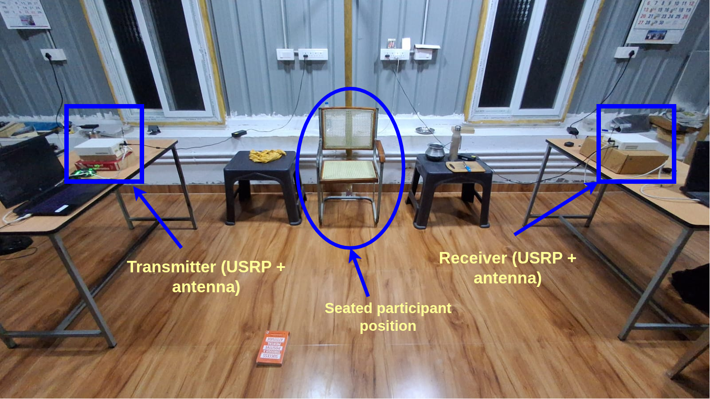
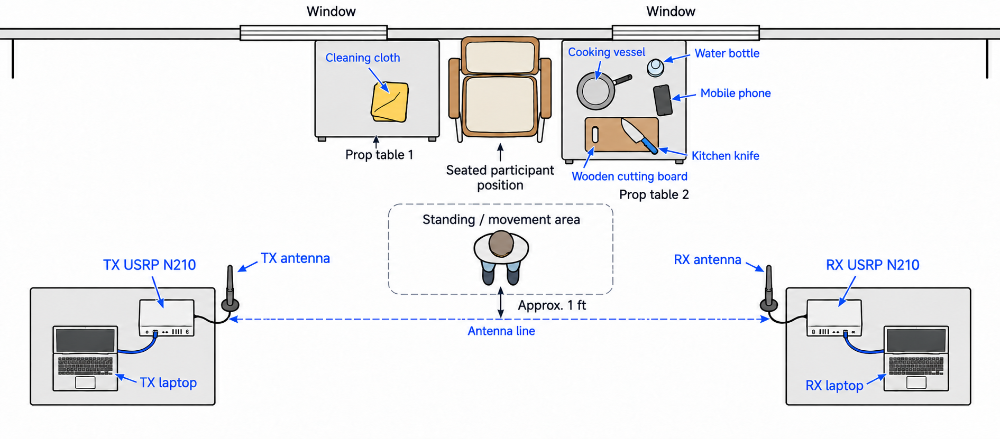
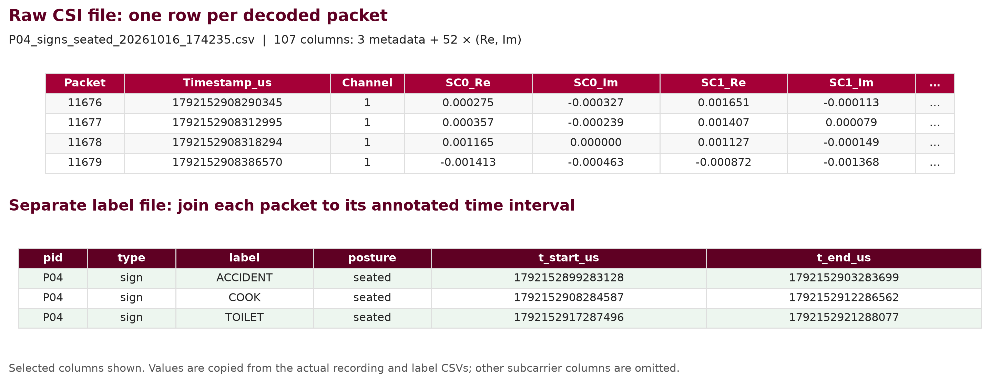
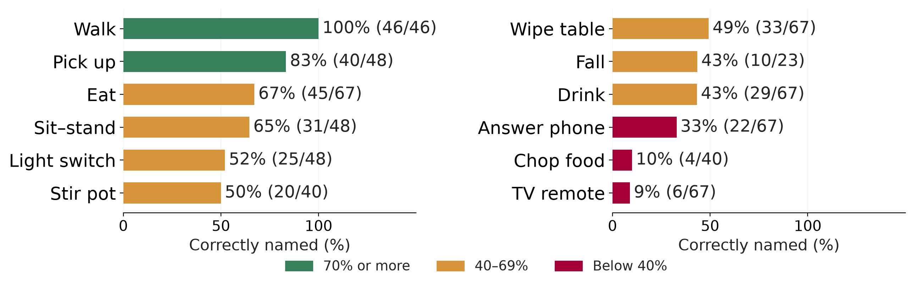
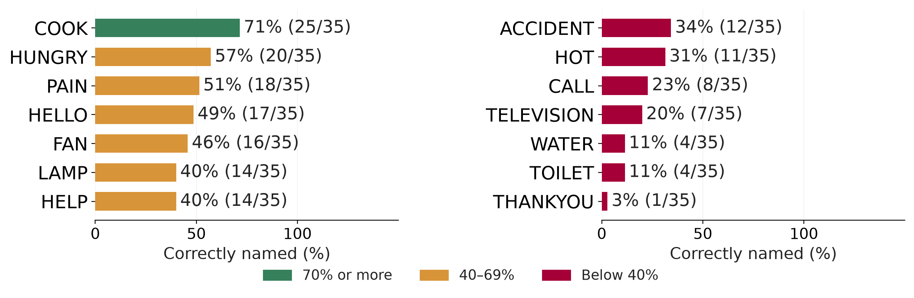
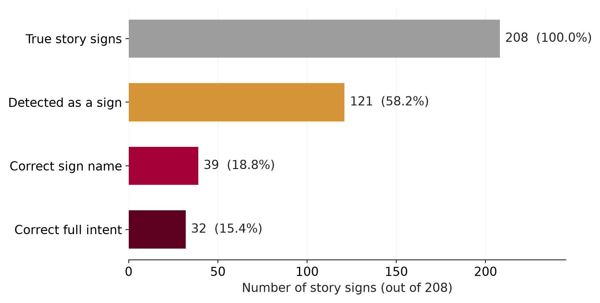

# Wi-Fi CSI Activity & Sign-Gesture Recognition

**Learning to distinguish everyday movement from deliberate sign gestures using a single Wi-Fi link.**

[Dataset · IEEE DataPort](https://doi.org/10.21227/tbq2-nc86) · [GPU training notebook](current_system/Kaggle_P1_P5/balanced_2h/FYP_P1_P5_Kaggle_BALANCED_2_Hours.ipynb) · [Saved results](current_system/Kaggle_P1_P5/balanced_results_audit_20261017/) · [Capture code](current_system/capture_snapshot/wifi_csi_capture/)

Final-year project, Department of Computer Science and Engineering, Amrita School of Computing, Amrita Vishwa Vidyapeetham, Coimbatore, India. **Group 067 · Vision, Language and Intelligent Learning (VLIL).**

## The problem

A smart home that responds to non-verbal commands must distinguish an intentional gesture from an ordinary action. Drinking from a bottle should not be mistaken for a **WATER** command. This project studies that distinction using channel state information (CSI): changes in the wireless channel caused by a person's movement.

The current implementation uses **two USRP N210 radios, one active participant and CSI amplitude as the model input**. It covers isolated daily activities, a 14-sign command vocabulary drawn from Indian Sign Language references, and scripted activity/sign stories. Earlier ESP32, passive USRP, wearable and public-benchmark experiments are preserved separately.

## Experimental setup



Two laptop-connected USRP N210 radios form a transmitter–receiver link. The chair and two prop tables sit against the rear wall; the standing reference is approximately one foot behind the antenna line, toward the wall. The cloth, cooking vessel, cutting board, knife, water bottle and phone support the recorded activities.



The layout illustrates the collection geometry rather than a surveyed floor plan. The dashed antenna line is a geometric reference, not a sensing boundary.

| Link property | Configuration |
|---|---|
| Radios | Two Ettus USRP N210 units with SBX daughterboards |
| Capture stack | GNU Radio, UHD, `gr-ieee802-11` and `gr-foo` |
| Centre frequency | 2412 MHz, Wi-Fi channel 1 |
| Radio sample rate | 20 MS/s |
| CSI per decoded frame | 52 complex subcarrier estimates |
| Transmitter target | 200 frames/s; actual decoded rates vary |
| Recorded signal | Packet counter, receiver timestamp, channel, real/imaginary CSI |
| Model representation | CSI amplitude, resampled to 50 Hz |

## Published dataset

**[Single-Link Wi-Fi CSI Dataset of Daily Activities and Sign Gestures from Five Participants](https://doi.org/10.21227/tbq2-nc86)**

DOI: **10.21227/tbq2-nc86**

| Collection | Verified quantity |
|---|---:|
| Participants | 5: P01–P05 |
| Participant recordings | 22 |
| Empty-room reference recordings | 3 |
| Total packet-level CSI rows | 2,050,030 |
| Participant CSI rows | 2,010,899 |
| Empty-room CSI rows | 39,131 |
| Columns per raw CSV | 107 |
| Fully covered isolated activity trials | 628 |
| Fully covered isolated sign trials | 490 |
| Scripted story runs | 34 |
| Labelled story steps | 208 activities + 208 signs |

The DataPort release contains numerical recordings, original labels, a combined event catalogue, metadata, documentation, checksums and Python reader/validation scripts. It is a **Standard Dataset**: the record is shareable, while file downloads depend on DataPort account or institutional access. Full participant videos and identity mappings are not included.

Only P04/P05 have the additional seated blocks and cooking activities. Twenty-seven incomplete P02 action intervals are excluded from complete-event evaluation. **Packet rows, trials and story steps are different units.**

### Recorded vocabulary

| Daily activities — 12 | Sign gestures — 14 |
|---|---|
| Walking, sitting down/standing up, picking up an object, operating a light switch, drinking, answering a phone, eating, wiping a table, using a TV remote, simulated fall onto a mattress, chopping food, stirring a pot | HELLO, THANKYOU, LAMP, FAN, TELEVISION, COOK, WATER, HOT, HUNGRY, TOILET, CALL, HELP, PAIN, ACCIDENT |

Stories combine meal preparation/eating, TV/phone use, cleaning/fall scenarios and seated routines. They follow fixed recorded templates, including transitions back from signs to activities; they are not spontaneous sign-language conversations.



## From recording to recognition

1. **Capture and label:** log complex CSI and receiver-clock event intervals, retaining empty-room references and recording-quality checks.
2. **Prepare the signal:** derive amplitude from each complex subcarrier, resample, handle signal-quality masks and form temporal windows.
3. **Train on Kaggle GPUs:** compare residual 1-D CNN representations, including four- and six-second windows and a window-normalized variant. Select settings on a validation participant and refit two seeds on the remaining training participants.
4. **Evaluate unseen people:** hold one participant out of both training and model selection. Repeat across P01–P05 and keep isolated classification separate from automatic continuous-story detection.
5. **Save reusable outputs:** retain model weights, class maps, preprocessing scales, configuration, predictions, selection metadata and checkpoint archives.

The retained completed run is **`FYP_BALANCED_2H_20261017_015419`**. Its all-five refit uses the four-second window-normalized residual network with two seeds. That refit uses all participants and has **no independent test score**. See the [saved model card](current_system/Kaggle_P1_P5/balanced_results_audit_20261017/run/FYP_BALANCED_2H_20261017_015419/results/deployment_all5/model_card.json).

## Results on held-out participants

| Evaluation task | Mean participant macro-F1 | Evaluated events |
|---|---:|---:|
| Isolated activity classification | **50.2%** | 628 |
| Isolated sign classification | **33.2%** | 490 |
| Story activity classification, supplied boundaries and type | 52.4% | 208 |
| Story sign classification, supplied boundaries and type | 24.7% | 208 |

These are averages of participant-level macro-F1 scores. The class plots below instead show **pooled per-class recall**: correctly named examples divided by all true examples of that class. They should not be read as macro-F1 or automatic detection scores.

### Daily activities: which classes are stronger?



Walking (**46/46**) and picking up an object (**40/48**) are the strongest classes in this evaluation. TV remote (**6/67**) and chopping food (**4/40**) are the weakest. These are results for the collected room and participants, not guarantees for new environments.

### Sign gestures: which classes are stronger?



COOK (**25/35**) is strongest, followed by HUNGRY (**20/35**). THANKYOU (**1/35**), WATER (**4/35**) and TOILET (**4/35**) remain difficult. The sign vocabulary needs further collection and validation before reliable use.

### Automatic recognition in stories



Across **208 true story signs**, the pipeline detects **121 (58.2%)** and correctly names **39 (18.8%)**. The final bar counts **32 correct sign-plus-predefined-response matches**; it does not establish learned intent understanding. There are also **50 unmatched commands during 20.3 minutes of routine activity**. Separating deliberate signs from surrounding movement is the main unresolved challenge.

The underlying [result tables](current_system/paper/evidence/) and [saved out-of-fold predictions](current_system/paper/evidence/all_out_of_fold_predictions.csv) allow these numbers to be checked without retraining.

## Use the repository

```bash
git clone https://github.com/aarga-labs/WiFi-CSI-HAR-ISL.git
cd WiFi-CSI-HAR-ISL
python3 tools/verify_repository.py
```

The repository is currently private, so cloning requires collaborator access. The verification command uses Python's standard library to check imported-file integrity, notebook structure, evidence hashes and saved evaluation results. It does not train a model or operate the radios.

For a new training run, open the [BALANCED Kaggle notebook](current_system/Kaggle_P1_P5/balanced_2h/FYP_P1_P5_Kaggle_BALANCED_2_Hours.ipynb) and read its [run instructions](current_system/Kaggle_P1_P5/balanced_2h/START_HERE_BALANCED.md). The original training ZIP and the published DataPort ZIP have different packaging; follow the notebook's expected input layout rather than assuming the archives are interchangeable. The newer `robust_2h` notebook is an unverified proposal, not the source of the results above.

| Location | Contents |
|---|---|
| [`current_system/capture_snapshot/`](current_system/capture_snapshot/) | USRP transmitter/receiver code and P04/P05 collection protocol |
| [`current_system/Kaggle_P1_P5/`](current_system/Kaggle_P1_P5/) | GPU notebooks, training source, retained outputs and model checkpoints |
| [`current_system/current_impl/`](current_system/current_impl/) | Class-performance figures, dataset excerpt and presentation assets |
| [`capture/esp32/`](capture/esp32/) | ESP32 CSI capture and ESPectre motion experiments |
| [`experiments/`](experiments/) | Passive USRP, SignFi, CASAS, ESP32 fall detection and IMU experiments |
| [`docs/reviews/`](docs/reviews/) | Review presentations and supporting material |
| [`provenance/`](provenance/) | Source inventories, checksums and dependency records |
| [`tools/`](tools/) | Repository verification and maintenance utilities |

## Scope and next steps

The current benchmark is **offline, CSI-only, single-person and single-room**. Event labels come from cues/operator keypresses and have not been independently checked against all collection videos. Seated/cooking coverage differs between participants, and acquisition date is partly tied to participant identity. The project does not yet establish continuous ISL translation, robust multi-person operation, validated sensor fusion or reliable automatic home control.

Next steps are additional participants/sessions and environments, independent annotation checks, improved seated/small-motion recognition, and reducing false commands in continuous use. Earlier public-benchmark and wearable experiments remain separate from this five-person collection.

## Team

| Student | GitHub |
|---|---|
| Adhikkesh S K | [Adhikkesh](https://github.com/Adhikkesh) |
| Adithya Ajay | [Achilles80](https://github.com/Achilles80) |
| Amrith B | [AMRITH03](https://github.com/AMRITH03) |
| Gowreesh B | [Gowreesh1905](https://github.com/Gowreesh1905) |
| Rishiikesh S K | [Rishiikesh-20](https://github.com/Rishiikesh-20) |

**Faculty guide: Ms. Nalinadevi K.**

## Attribution and reuse

Cite the [IEEE DataPort dataset record](https://doi.org/10.21227/tbq2-nc86) when using the released collection, and follow the licence/access terms shown there. GNU Radio, UHD, `gr-ieee802-11`, ESPectre, ESP32 CSI tools and public benchmark resources retain their upstream attribution and licences. See [NOTICE.md](NOTICE.md) and [dependency notes](docs/DEPENDENCIES.md); the dataset's terms do not automatically license every code component in this repository.
