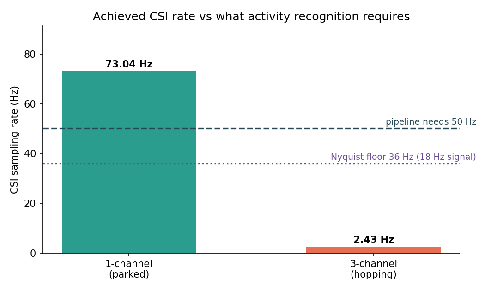
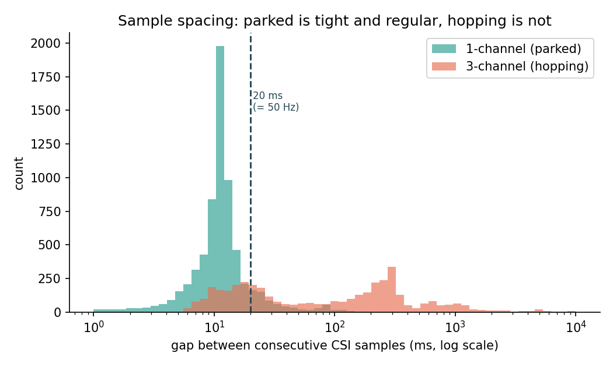
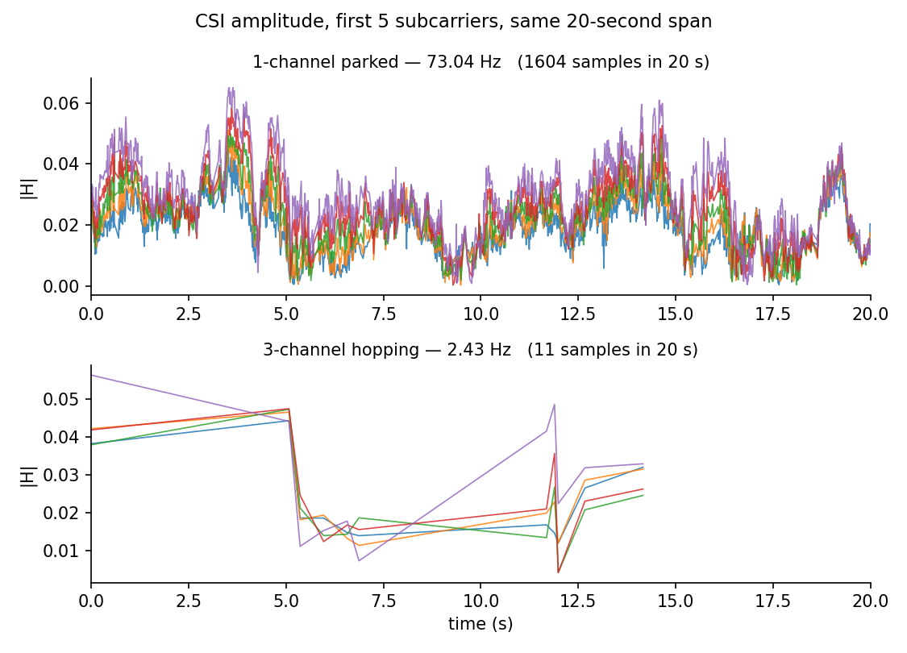
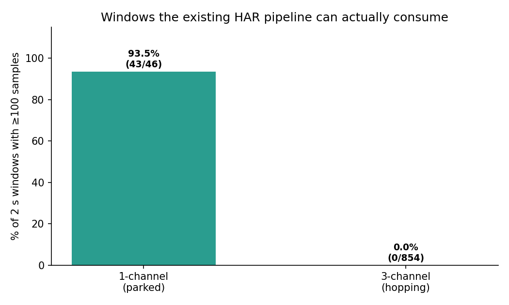

# Three-Channel WiFi CSI for Activity Recognition — Feasibility Analysis

**Project:** Two-USRP WiFi CSI Human Activity Recognition
**Date:** 13 August 2026
**Scope:** Whether three-channel operation (WiFi channels 1 / 6 / 11) can support
activity recognition, and how best to use two USRP N210s to get there.

Every number in this document is measured from our own captures. The analysis is
reproducible with `python3 doc/analyze_channels.py`, which regenerates
`doc/channel_stats.json` and all figures.

---

## 1. Summary

We built the three-channel system, fixed three defects in it, and verified it
works correctly — all three channels are captured, with balanced coverage
(1465 / 1434 / 1242 packets across channels 1 / 6 / 11).

Having measured it, we found that **channel hopping and activity recognition
place opposite demands on the radio**, and the conflict is a hardware and physics
limit rather than a software problem:

| Measurement | 1 channel (parked) | 3 channels (hopping) |
|---|---|---|
| CSI sampling rate | **73.0 Hz** | **2.4 Hz** |
| Median gap between samples | 11.4 ms | 89.2 ms |
| Largest gap observed | 187 ms | **55.6 s** |
| Samples in a typical 2-second window | **155** | **1** |
| Windows our HAR pipeline can process | **93.5 %** | **0 %** |

The last row is the decisive one. Our existing, working HAR pipeline
(`Action_NoAction_imgfi.ipynb`) needs **100 samples per 2-second window**. In a
28-minute three-channel capture, **0 of 854 windows** reached that. Not a
reduced number — zero.

**This does not mean abandoning three-channel work.** It means collecting each
channel at full rate in its own session, rather than switching between channels
during an activity. That approach answers the same research question, with data
that is actually usable. Section 8 sets it out.

---

## 2. Background: what the system does

Two USRP N210 software-defined radios, one transmitting and one receiving:

```
 Laptop A (TX)                                    Laptop B (RX)
 packet_generator.py  --TCP-->  wifi_tx.py            wifi_rx.py
 200 packets/sec                     |                     |
                                     v                     v
                              USRP N210  ===== radio =====> USRP N210
                                                             |
                                                             v
                                            52 subcarrier CSI --> CSV
```

**Channel State Information (CSI)** describes how a radio signal was altered on
its way from transmitter to receiver. Each packet yields 52 complex numbers, one
per OFDM subcarrier. When a person moves through the space, they change how the
signal reflects, and the CSI values change with them. Activity recognition works
by learning those patterns of change over time.

The essential point for everything below: **CSI is a time series.** A single
measurement says nothing about activity. What carries the information is *how the
values change from one packet to the next.* That makes the rate of measurement,
and its regularity, the properties that matter most.

---

## 3. What activity recognition requires

### 3.1 From our own earlier analysis

Our July pilot study (`analysis/comparative_analysis.pdf`) measured, on our own
data, where the activity-discriminating information actually sits in frequency:

> All class-discriminative energy lies below **18 Hz**.

By the Nyquist sampling theorem, capturing an 18 Hz signal requires sampling at
**at least 36 Hz**. Below that, the information is not merely degraded — it is
irrecoverably lost, and worse, folds back into the data disguised as false
low-frequency content (aliasing).

### 3.2 From our existing pipeline

`Action_NoAction_imgfi.ipynb` — the model that already works — hardcodes:

```python
WINDOW_SECONDS = 2
RATE = 50
WINDOW_SIZE = WINDOW_SECONDS * RATE   # = 100 samples per window
```

Every training example is a 2-second window containing 100 CSI samples. This is
a hard input requirement, not a preference.

### 3.3 From the published literature

Reported WiFi CSI sensing rates range from about **50 Hz to 1500 Hz**, with
50 Hz described as around the practical lower bound for activity recognition
[[Wi-Fi Sensing Survey, ACM Computing Surveys 2025](https://dl.acm.org/doi/10.1145/3705893)],
[[WiFi Sensing with CSI: A Survey](https://dl.acm.org/doi/fullHtml/10.1145/3310194)].

**Three independent sources converge on ~36–50 Hz as the minimum.** Our parked
single-channel capture delivers 73 Hz. Three-channel hopping delivers 2.4 Hz.

---

## 4. What we measured

### 4.1 Sampling rate



Three-channel hopping sits at 2.4 Hz — roughly **15× below the Nyquist floor**
and **20× below what our pipeline needs**.

### 4.2 Regularity



Rate alone understates the problem. Parked operation produces tightly clustered
gaps around 11 ms. Hopping produces a smeared distribution spanning four orders
of magnitude, from milliseconds to **55 seconds**.

Nearly all CSI processing — spectrograms, wavelet transforms, sliding-window
statistics — assumes evenly spaced samples. Irregular data must either be
interpolated (inventing values that were never measured) or discarded.

### 4.3 What the signal looks like



The same 20-second span, same subcarriers, same activity. Parked operation
captured **1604 samples**; hopping captured **11**.

The top panel is a signal — the oscillations are footsteps, and a model can learn
them. The bottom panel is eleven dots joined by straight lines. Those lines are
drawn by the plotting software, not measured: nothing whatsoever is known about
what happened between them. This single comparison is the clearest statement of
the problem in the whole document.

### 4.4 Usable windows — the decisive result



| Capture | Duration | 2 s windows | Usable (≥100 samples) |
|---|---|---|---|
| 1-channel, subject A | 91.8 s | 46 | **43 (93.5 %)** |
| 1-channel, subject B | 89.3 s | 45 | **40 (88.9 %)** |
| 3-channel hopping | 1707.4 s | 854 | **0 (0.0 %)** |

Twenty-eight minutes of three-channel recording produced **no usable training
examples at all**. The median 2-second window contained **1 sample** where 100
are required.

---

## 5. Sample data

Real rows from both captures. `gap_ms` is the elapsed time since the previous
sample.

### 5.1 One channel, parked (subject walking)

```
 Pkt  gap_ms  Ch    SC0_Re    SC0_Im   SC25_Re   SC25_Im
   0       -   -  0.017418  -0.01123  0.061426  -0.10012
   1     4.3   -  0.014159  -0.01536  0.058670  -0.10211
   2    10.3   -  0.012302  0.016840  0.057839  -0.10638
   3     6.2   -  0.022694  -0.00279  0.059958  -0.09741
   4    13.9   -  0.003843  0.020647  0.062577  -0.09493
   5     6.6   -  0.017635  0.005921  0.057508  -0.08970
   6    30.6   -  0.004190  0.015190  0.044635  -0.08010
   7     0.8   -  0.012586  -0.00687  0.033187  -0.08154
```

Samples arrive every few milliseconds, and `SC25_Re` drifts smoothly
(0.0614 → 0.0587 → 0.0578 → 0.0600 …). That smooth drift *is* the person moving.
A model can learn from it.

### 5.2 Three channels, hopping

```
 Pkt  gap_ms  Ch    SC0_Re    SC0_Im   SC25_Re   SC25_Im
   0       -  11  0.027714  0.026374  0.362762  0.041905
   1  5073.0  11  0.013701  -0.04211  0.251975  -0.00195
   2   287.4   6 -0.007970  -0.01688  0.300588  -0.02676
   3   604.3   6  0.014571  -0.01166  0.383778  -0.01630
   4   605.5  11  0.005598  -0.01372  0.405158  -0.06393
   5   300.3  11 -0.011910  -0.00737  0.186769  -0.11723
   6  4814.7   6  0.011930  -0.01194  0.252483  -0.02868
   7   207.0   6  0.013746  -0.00518  0.370381  -0.02365
```

Three problems are visible in eight rows:

1. **A 5-second gap between the first two samples.** Any activity in that window
   went unrecorded.
2. **The channel column jumps 11 → 11 → 6 → 6 → 11 → 11 → 6.** Consecutive
   samples come from different radio frequencies, so they are not measurements of
   the same thing (Section 6.2).
3. **Even filtering to one channel doesn't rescue it.** Successive channel-11
   samples are 5073 ms and 605 ms apart — roughly 2 Hz.

`SC25_Re` reads 0.363, 0.252, 0.301, 0.384, 0.405 … These jumps are not the
person moving. They are the receiver landing on different frequencies seconds
apart. The motion information is gone.

---

## 6. Why hopping costs so much

Three separate causes compound. None is a coding defect.

### 6.1 The radio takes longer to change channel than it spends on one

Changing frequency requires the local oscillator to re-lock. Ettus Research, who
manufacture the USRP, state that after a retune approximately **110 ms** should
be allowed for the LO to lock
[[Ettus KB](https://kb.ettus.com/Synchronizing_USRP_Events_Using_Timed_Commands_in_UHD)].

Our dwell time is **100 ms per channel**.

> **The radio needs ~110 ms to become ready, and we give it 100 ms before moving
> on. It is settling for most of the time it is supposed to be listening.**

Our measurements agree: a productive 100 ms dwell delivered a mean of **1.8
packets** where a 50 packet/s transmitter should have fitted about 5 — indicating
roughly 60 ms of every 100 ms dwell is lost to retuning and re-synchronisation,
on each radio independently.

This also answers a natural follow-up — *would hopping faster help?* No. The
settling cost is fixed per hop, so shortening the dwell increases the number of
hops and therefore the total overhead. At a 50 ms dwell the radio would never
finish settling at all.

| Dwell | Settling cost | Productive window | Result |
|---|---|---|---|
| 50 ms | ~110 ms | none | nothing captured |
| 100 ms (current) | ~110 ms | marginal | 2.4 Hz measured |
| 500 ms | ~110 ms | ~390 ms | better, still split 3 ways |
| Parked | none | 100 % | 73 Hz |

### 6.2 The room changes faster than we can visit all three channels

The **coherence time** of a wireless channel is how long the environment stays
effectively unchanged. Indoors it is roughly **25–150 ms**, and about **25 ms**
when a person is moving at walking speed (1 m/s)
[[REACT: Rate Adaptation using coherence time in 802.11 WLANs](https://www.researchgate.net/publication/220213254_REACT_Rate_Adaptation_using_coherence_time_in_80211_WLANs)].

Our full hop cycle is 3 × 100 ms = **300 ms**.

> **By the time we return to channel 1, the room is no longer the room we
> measured. The three channels are snapshots of three different moments, not
> three views of one moment.**

An analogy: photographing a running person with a camera that takes 100 ms to
change lenses. Each photo is sharp, but the person has moved between them, so the
three cannot be combined into a single picture.

This is why published multi-channel sensing systems hop **within** the coherence
time — reported hop delays as low as **0.2 ms** so all channels are probed before
the environment changes [[WiFi Sensing with CSI: A Survey](https://dl.acm.org/doi/fullHtml/10.1145/3310194)].
That is roughly **500× faster than a USRP N210 can retune**. The technique is
sound; this hardware cannot execute it.

### 6.3 Why not avoid hopping entirely — capture all channels at once?

A natural and correct instinct: instead of *switching between* channels in time,
receive a wide band covering all of them and separate the channels in software.
This is frequency-division rather than time-division, and it would eliminate both
problems above simultaneously — no retuning, and all channels measured at the
same instant. It is what an ideal solution looks like.

It is blocked by hardware bandwidth, on both radios.

Channels 1 and 11 are 50 MHz apart in centre frequency, and each occupies
20 MHz, so the full span is **70 MHz**:

```
ch1:  2402 -------- 2422 MHz
ch6:            2427 -------- 2447 MHz
ch11:                     2452 -------- 2472 MHz
      |------------- 70 MHz total span -------------|
```

Probing our own receiver (`uhd_usrp_probe --args="addr=192.168.10.7"`):

```
RX Dboard: A    ID: SBX (0x0054)
  Freq range:      400.000 to 4400.000 MHz
  Bandwidth range: 40000000.0 to 40000000.0 step 0.0 Hz
```

| Constraint | Capability | Required | Short by |
|---|---|---|---|
| Gigabit Ethernet to host | 25 MS/s → **~20 MHz** usable | 70 MHz | 3.5× |
| SBX daughterboard analog filter | **40 MHz** (fixed) | 70 MHz | 1.75× |

Our flowgraph already runs at `samp_rate = 20e6` — **already at the platform's
practical ceiling.** There is no unused headroom. This is not coincidental: a
WiFi channel is 20 MHz wide precisely because that is a natural unit for this
class of radio.

Reducing sample precision to 8 bits raises the link to 50 MS/s, but the SBX's
40 MHz analog filter still blocks the span, and even channels 1 and 6 alone are
45 MHz apart.

**The constraint that is easiest to overlook: the transmitter has the same
limit.** CSI measures how a *known transmitted signal* was altered — where no
signal is transmitted, there is no channel to estimate. Our transmitting N210 can
illuminate only one 20 MHz channel at a time, so even a wideband receiver would
observe our packets on one channel and nothing but noise on the other two.
Wideband reception only helps if paired with wideband transmission.

**What hardware would suffice:** a USRP X310 with a UBX-160 daughterboard offers
160 MHz of bandwidth over 10 Gigabit Ethernet, enough to transmit and receive all
three channels simultaneously. That is a different hardware class rather than a
configuration change. Should such equipment become available, this becomes the
technically superior approach and this analysis should be revisited.

For completeness: the N210's FPGA does process 100 MS/s internally, so
custom FPGA logic extracting three 20 MHz channels is conceivable. It would
require 60 MS/s across a 25 MS/s link, remains blocked by the 40 MHz analog
filter, and represents a substantial FPGA engineering effort. It is not a
practical route.

### 6.4 Each retune resets the phase reference

Retuning restarts the local oscillator, so carrier frequency offset and sampling
time offset change discontinuously at every hop. Phase-derived features — often
the most informative in CSI sensing — are therefore not comparable across hops.
Amplitude survives; phase does not.

---

## 7. Where three-channel operation genuinely helps

Being fair to the approach, multi-channel CSI is valuable, and it is a legitimate
research direction. What matters is matching the method to the goal.

**Established strengths, well supported in the literature:**

| Application | Why multi-channel helps | Works here? |
|---|---|---|
| **Indoor localization / ranging** | Combining channels synthesises a wider effective bandwidth, giving finer time-of-flight resolution — decimetre and centimetre-level positioning | Needs sub-millisecond hopping — **not achievable on N210** |
| **Frequency diversity / robustness** | Different channels fade differently; one may carry an activity better than another | **Yes — via sequential sessions** |
| **Channel selection** | Empirically identify the best channel for sensing in a given room | **Yes — via sequential sessions** |
| **Interference resilience** | If channel 1 is congested, fall back to 6 or 11 | **Yes — via sequential sessions** |
| **Multi-channel fusion for HAR** | Combine features from several channels for higher accuracy | **Yes — via sequential sessions** |

The distinction is simple: uses that require the three channels to be measured
*at the same instant* are out of reach on this hardware. Uses that compare
channels *across sessions* are fully achievable, and cover most of the value.

**Note also:** the 52 subcarriers we already record span 20 MHz and are
themselves a form of frequency diversity. Our July analysis found an effective
rank of about **3.5** across those 52 subcarriers — meaning they carry roughly
3–4 independent dimensions rather than 52. Adding more frequencies is a
reasonable way to seek genuinely new information; the question is how to do so
without destroying the time series.

---

## 8. Recommended approach

**Record each channel at full rate, in its own session.**

```
Session 1:  both radios parked on channel 1   -> full activity set at ~73 Hz
Session 2:  both radios parked on channel 6   -> full activity set at ~73 Hz
Session 3:  both radios parked on channel 11  -> full activity set at ~73 Hz
```

Antenna positions stay fixed across all three sessions, so the only variable is
frequency.

**What this delivers:**

- Three complete, usable datasets instead of one unusable interleaved stream
- Every dataset compatible with the existing pipeline, unmodified
- A direct, controlled answer to *"does channel choice affect activity
  recognition accuracy?"* — train on each channel, compare
- Multi-channel fusion still possible by combining per-channel features
- Standard practice: this is how frequency-diversity comparisons are normally run

**What it gives up:** simultaneity. The three channels are not measured at the
same instant. For activity recognition this costs nothing — we classify a
2-second activity window, not a microsecond-scale event. Simultaneity matters for
localization and ranging, which is not our objective.

This is already implemented. Setting `CSI_CHANNEL` on the receiver and
`TX_CHANNEL` on the transmitter parks both radios; leaving them unset restores
hopping. No code changes are needed to switch between the two modes.

---

## 9. What the two-USRP setup gives us

Worth stating plainly, because this is a real advance over the July pilot
regardless of the channel question.

The July pilot **passively sniffed** an existing WiFi link between a MacBook and
a hotspot. That meant no control over the packet rate — it was whatever that link
happened to produce, drifting between **26 and 133 packets/s** within a single
capture.

With our own transmitter we now control:

| Property | Passive sniffing (July) | Two USRPs (now) |
|---|---|---|
| Packet rate | uncontrolled, 26–133/s | **set by us — 200 pkt/s** |
| Rate stability | drifts with the other link's traffic | **constant** |
| MAC addresses | whatever the devices used | **fixed, known** |
| Channel | whatever the hotspot chose | **our choice, including 1/6/11** |
| Repeatability | depends on external traffic | **fully reproducible** |
| Payload / labelling | none | **sequence numbers, timestamps, labels** |

This directly fixes a limitation identified in our July analysis: 13 % of windows
were silently dropped because the capture rate was inconsistent. A controlled
transmitter removes that failure mode.

**It is also what makes the three-channel study possible in the first place.**
Passive sniffing cannot choose a channel — the hotspot decides. Owning the
transmitter is what lets us record channels 1, 6 and 11 under identical
conditions and compare them fairly.

---

## 10. Work completed

The three-channel receiver did not work when we started. Three defects were found
and fixed, each of which failed silently — no error message, just an empty or
misleading output file:

| # | Defect | Effect | Status |
|---|---|---|---|
| 1 | CSI extractor required metadata fields (`ta`/`ra`) that only exist on WiFi *Control* frames, while our transmitter sends *Data* frames (which use `address 2`/`address 1`) | **Every packet silently discarded** — CSV never contained a single row | Fixed |
| 2 | CSV written to disk only every 100 rows | Captured data invisible for minutes; appeared as total failure | Fixed |
| 3 | No channel-hop loop existed in the receiver | Receiver stayed on channel 1 permanently while reporting "Channel 1" for every row — indistinguishable from correct output | Fixed |

After these fixes the system captures all three channels correctly and in
balance. **The conclusion in this document is therefore not "we could not get it
working" — it is a measurement taken from a system that works.**

---

## 11. Conclusion

Three-channel hopping and activity recognition are individually sound, but they
cannot be combined on this hardware: hopping costs a factor of ~30 in sampling
rate, which takes us from 73 Hz to 2.4 Hz, against a requirement of at least
36 Hz. The limits are the USRP N210's ~110 ms retune time and the ~25 ms
coherence time of a room with a person moving in it — hardware and physics,
not implementation.

Recording each channel at full rate in its own session preserves the entire
three-channel research question while producing data the existing pipeline can
use. We recommend proceeding that way, beginning with a short pilot on channel 1
to confirm end-to-end quality before committing to a full collection.

---

## 12. References

1. [Wi-Fi Sensing Techniques for Human Activity Recognition: Brief Survey, Potential Challenges, and Research Directions — ACM Computing Surveys, 2025](https://dl.acm.org/doi/10.1145/3705893)
2. [WiFi Sensing with Channel State Information: A Survey — ACM Computing Surveys](https://dl.acm.org/doi/fullHtml/10.1145/3310194)
3. [Synchronizing USRP Events Using Timed Commands in UHD — Ettus Research Knowledge Base](https://kb.ettus.com/Synchronizing_USRP_Events_Using_Timed_Commands_in_UHD)
4. [REACT: Rate Adaptation using coherence time in 802.11 WLANs](https://www.researchgate.net/publication/220213254_REACT_Rate_Adaptation_using_coherence_time_in_80211_WLANs)
5. [Understanding and Modeling of WiFi Signal Based Human Activity Recognition — MobiCom 2015](https://www.sigmobile.org/mobicom/2015/papers/p65-wangA.pdf)
6. [A Survey on Behaviour Recognition Using WiFi Channel State Information](https://arxiv.org/pdf/1708.07129)
7. [Exploring Frequency Tuning Policies for USRP-N210 SDR Platform and GNU Radio](https://www.researchgate.net/publication/259865104_Exploring_Frequency_Tuning_Policies_for_USRP-N210_SDR_Platform_and_GNU_Radio)
7a. [About USRP Bandwidths and Sampling Rates — Ettus Research Knowledge Base](https://kb.ettus.com/About_USRP_Bandwidths_and_Sampling_Rates)
7b. [N200/N210 Device Overview — Ettus Research Knowledge Base](https://kb.ettus.com/N200/N210)
8. Internal: `analysis/comparative_analysis.pdf` — July 2026 pilot study
9. Internal: `Action_NoAction_imgfi.ipynb` — existing HAR pipeline
10. Internal: `doc/channel_stats.json` — all measurements in this document

---

## Appendix A — Reproducing these results

```bash
cd ~/usrp-projects/Three_Channel_Experiment
python3 doc/analyze_channels.py
```

Regenerates `doc/channel_stats.json` and every figure from the raw CSVs in
`~/usrp-projects/data/`. Requires `numpy` and `matplotlib`.

## Appendix B — Measurement provenance

| Figure | Source capture |
|---|---|
| 1-channel | `data/pilot/P01_action_amrith_20260717_walk.csv` (6707 rows, 91.8 s) |
| 1-channel (2nd subject) | `data/pilot/P01_action_gowreesh_20260721_walk.csv` (5130 rows, 89.3 s) |
| 3-channel | `data/3ch_test_20260813_001142.csv` (4141 rows, 1707.4 s) |

The three-channel capture was recorded after all three defects in Section 10 were
fixed, with the transmitter confirmed running throughout.
