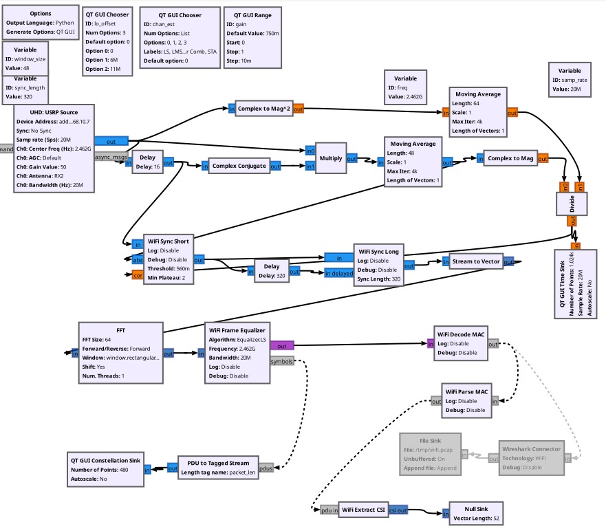

# WiFi CSI-Based Human Activity Detection (Action / No-Action)

Binary human activity detection using WiFi Channel State Information (CSI)
passively sensed with a USRP N210 software-defined radio, classified with a
CNN trained on the captured CSI.

## Overview

Two WiFi stations — a laptop (A) and a hotspot/router (B) — maintain a normal
WiFi link on the 2.4 GHz band (channel 1, 6, or 11). A person stands in the
direct radio path between A and B and either performs an action or remains
idle. A USRP N210, placed on the opposite side of the person from the A–B
link, passively overhears the same RF energy that A radiates toward B — it is
not associated with the network and does not need to be.

```
              A (laptop)
                    │
USRP N210 ──── Person
 (passive           │
  RF sniffer)       │
              B (hotspot / router)
```

The USRP digitizes the intercepted signal into complex I/Q samples, which
GNU Radio and a modified IEEE 802.11 OFDM receiver decode. During decoding,
the receiver estimates the wireless channel (CSI) from the known training
symbols in each WiFi frame. Because the person's presence and movement
perturb the multipath environment between A and B, the shape of the CSI
across subcarriers changes depending on whether the person is active or
idle — this is the signal the classifier is trained on.

## Hardware

- USRP N210 with SBX Rev. 3 daughterboard (RX2 antenna)
- Two WiFi stations forming the link being sensed (e.g., a laptop + a router/hotspot)

> **Antenna placement:** Avoid placing the USRP immediately next to
> the WiFi router/hotspot — this can saturate the receive front end.
> A reasonable starting layout is a couple of meters between the
> transmitting device and the person, and a similar distance between
> the person and the USRP.

## Software Stack

- UHD v4.8
- GNU Radio 3.10
- [gr-ieee802.11](https://github.com/bastibl/gr-ieee802-11) (GPL-3.0) — OFDM PHY, modified for CSI extraction (see [NOTICE.md](./NOTICE.md))

## Repository Structure
```
.
├── README.md
├── LICENSE                          # GPL-3.0
├── NOTICE.md                        # attribution for modified upstream files
├── images/
│   └── wifi_rx_flowgraph.png        # annotated receive flowgraph
├── gnuradio/
│   ├── wifi_rx.grc                  # modified receive flowgraph
│   ├── wifi_rx.py                   # generated + modified receiver script
│   └── extract_csi_block/
│       ├── extract_csi_impl.cc      # CSI extraction block implementation
│       └── extract_csi_impl.h
├── scripts/
│   └── segment_windows.py           # raw capture CSV -> 52x200 .npy windows
├── data/
│   ├── README.md                    # CSI data format description
│   └── pilot/
│       ├── P01_<class>_<subject>_<date>_<take>.csv    # raw CSI captures
│       ├── *_check.png                               # per-capture quality plots
│       └── windows/                                  # generated, not committed
├── notebooks/
│   └── Action_NoAction_CNN_GRU.ipynb # preprocessing, training, evaluation
└── models/                          # saved model weights
```

## Receiver Chain

`gnuradio/wifi_rx.grc` / `wifi_rx.py` is a modified version of the
`wifi_rx.grc` example shipped with gr-ieee802.11.



The flowgraph above is the complete capture pipeline as it appears in GNU Radio
Companion. Reading it left to right:

- **Top-left variables** set the capture: `samp_rate` (20 MHz), `freq`
  (2.462 GHz), `window_size` (48) and `sync_length` (320) for the
  synchronisation stages, plus two runtime QT GUI controls — `chan_est`
  (LS / LMS / Linear Comb / STA) and `gain` — that can be changed while the
  flowgraph runs.
- **UHD: USRP Source** is the only source block. Everything downstream operates
  on the complex I/Q stream it produces.
- **The two parallel branches** immediately after the source implement
  Schmidl-Cox style packet detection. The upper branch computes `|x|²` and
  smooths it with a 64-tap moving average (received power). The lower branch
  delays the signal by 16 samples, conjugate-multiplies it against the
  undelayed stream, and smooths that with a 48-tap moving average
  (autocorrelation of the short training field). The **Divide** block
  normalises autocorrelation by power, which makes the detection metric
  independent of absolute signal strength — this is what the **QT GUI Time
  Sink** on the far right displays.
- **WiFi Sync Short** takes that normalised metric plus the raw stream and
  fires when the correlation plateau exceeds `0.56`. **WiFi Sync Long** then
  performs fine timing and frequency alignment against the long training field.
- **Stream to Vector → FFT (64-point)** converts each aligned OFDM symbol from
  time domain to frequency domain — the point at which per-subcarrier values
  exist at all.
- **WiFi Frame Equalizer** estimates and applies the channel correction, then
  emits both equalized symbols and the decoded bits. **WiFi Decode MAC** and
  **WiFi Parse MAC** recover the 802.11 MAC frame.
- **WiFi Extract CSI** (bottom right) is the block added for this project. It
  taps the equalizer's PDU output and writes the 52-subcarrier complex channel
  estimate per frame to disk. Its stream output is terminated by a **Null
  Sink** (vector length 52) because the CSI leaves through the file writer, not
  the flowgraph.
- **Greyed-out blocks** (File Sink → `/tmp/wifi.pcap`, Wireshark Connector) are
  the optional packet-logging path, disabled by default. The **QT GUI
  Constellation Sink** on the lower left shows equalized symbols and is used to
  confirm demodulation quality at a glance — a tight QPSK/QAM constellation
  means the chain is locked on.

Stage by stage:

1. **UHD USRP Source** — captures raw I/Q at 20 MHz sample rate, default
   center frequency 2.462 GHz (WiFi channel 11), configurable via the
   `freq`, `gain`, and `lo_offset` variables.
2. **Packet detection & synchronization** — short/long preamble correlation
   (`WiFi Sync Short`, `WiFi Sync Long`) for timing/frequency sync.
3. **FFT + Frame Equalizer** — OFDM demodulation and channel equalization,
   with a selectable estimator (`chan_est`: LS, LMS, Linear Comb, or STA).
4. **MAC decode/parse** — `WiFi Decode MAC` and `WiFi Parse MAC` recover the
   802.11 MAC frame from the equalized symbols.
5. **WiFi Extract CSI** — a custom block added to the receiver that pulls
   the per-subcarrier channel estimate (52 subcarriers — the standard 48
   data + 4 pilot subcarriers of 802.11a/g OFDM) out of each decoded frame.

   Conceptually, each subcarrier's channel estimate is computed from the
   received and known-transmitted long training field (LTF) symbols:

   **H(k) = Y(k) / X(k)**

   where `Y(k)` is the received subcarrier value, `X(k)` is the known
   transmitted training symbol, and `H(k)` is the resulting complex
   channel estimate for subcarrier `k`. The vector of `H(k)` across all
   52 subcarriers is the CSI captured for each frame.
6. **QT GUI sinks** — a time sink (correlation magnitude, for visually
   confirming packet detection) and a constellation sink (equalized
   symbols, for visually checking demodulation quality) are included for
   live debugging; the optional Wireshark/pcap logging path is present but
   disabled by default.

## Setup

1. Install GNU Radio 3.10, UHD 4.8, and `gr-foo`/`gr-ieee802.11` following
   the [upstream instructions](https://github.com/bastibl/gr-ieee802-11).

```bash
git clone https://github.com/bastibl/gr-ieee802-11
cd gr-ieee802-11
mkdir build && cd build
cmake ..
make -j$(nproc)
sudo make install
sudo ldconfig
```

### Verify the hardware

Confirm the N210 is detected and the front end is working before
touching the flowgraph:

```bash
# Detect connected USRP devices
uhd_find_devices

# Probe hardware details — confirms SBX Rev.3 front end, clock rate, etc.
uhd_usrp_probe
```

2. Copy `gnuradio/wifi_rx.grc` and `gnuradio/wifi_rx.py` from this repo into
   your gr-ieee802.11 `examples/` folder (or open the `.grc` directly in
   GNU Radio Companion).

### Choosing the WiFi channel / frequency

Set `freq` to match the channel your WiFi link (A ↔ B) is using:

| Channel | Center Frequency |
|---|---|
| 1  | 2412 MHz |
| 6  | 2437 MHz |
| 11 | 2462 MHz |

Check which channel your router/hotspot is actually on:

```bash
nmcli dev wifi
# or
iw dev wlan0 link
```

3. Set `uhd_usrp_source_0`'s device address to match your N210, and adjust
   `freq`/`gain` for your setup.

> **Gain tuning:** If packets aren't decoding, raise gain gradually
> (e.g. 30 → 35 → 40 → 45 → 50 dB) rather than jumping to max — pushing
> gain too high can saturate the receive front end. Back it off if you
> see saturation artifacts.

4. Run the flowgraph while the WiFi link between A and B is active, and the
   person performs the "action" / "no-action" behavior you want to capture.
   Each run writes one CSI capture CSV into `data/pilot/`.

5. Segment the captures into fixed-length model inputs. `segment_windows.py`
   handles one capture per invocation, deriving the class and subject from the
   filename:

```bash
for f in data/pilot/P01_*.csv; do
  b=$(basename "$f" .csv)
  python3 scripts/segment_windows.py "$f" \
      --action  "$(echo "$b" | cut -d_ -f2)" \
      --subject "$(echo "$b" | cut -d_ -f3)" \
      --out-dir data/pilot/windows
done
```

   This writes `data/pilot/windows/{action,noaction}/*.npy`, each of shape
   `52 x 200`. The window directory is generated output and is **not** committed
   — regenerate it after cloning.

> **Do not change `--rate` or `--window`.** The output width is
> `rate x window`, and the model expects exactly 200 time steps. The defaults
> (`--rate 100 --window 2`) produce that; anything else silently yields inputs
> that do not match the architecture or the trained checkpoints.

6. Open the notebook:

```bash
jupyter notebook notebooks/Action_NoAction_CNN_GRU.ipynb
```

## Dataset

Each decoded WiFi frame yields one CSI observation: a complex-valued vector
across 52 OFDM subcarriers. Captures are labeled by session as `action` or
`noaction` based on what the person was doing during recording.

The pilot set in `data/pilot/` contains 12 captures from 3 subjects
(anonymised as `S01`–`S03`), covering four take types: `walk` and `mixed` for
`action`, `sit` and `stand` for `noaction`. `scripts/segment_windows.py`
converts these into 2-second windows of shape `52 x 200`, yielding **496
windows** (254 `action` / 242 `noaction`; 182 / 174 / 140 per subject). Only the
raw captures are committed — the windows are regenerated with the command in
step 5 above. See [data/README.md](data/README.md) for the on-disk format.

## Model

[notebooks/Action_NoAction_CNN_GRU.ipynb](notebooks/Action_NoAction_CNN_GRU.ipynb)
covers preprocessing, training and evaluation. The classifier is a
CNN → BiGRU → attention network (~570k parameters) that takes the whole
`52 x 200` amplitude window as one input, treating the 52 subcarriers as CNN
input channels so a filter sees all of them at every time step.

Only amplitude `|H|` is used. The USRP is not frequency- or time-synchronised
to the transmitter, so every packet carries an unknown carrier-frequency,
sampling-frequency and timing offset — raw phase is not usable without
synchronisation, while amplitude is unaffected.

Evaluation is **leave-one-subject-out**: each subject is held out in turn while
the model trains on the rest. Windows from a single take are highly correlated,
so a random split would place near-duplicates on both sides and report a
meaningless score. Normalisation statistics are computed on the training split
only, and checkpoint selection uses a validation set drawn from the training
subjects — never the held-out one.

> The checkpoints in `models/` are from an earlier two-subject run (S01 and S03
> only, 322 windows). Re-running the notebook over all three subjects retrains
> from scratch and overwrites them.

## License & Attribution

This project is licensed under **GPL-3.0** (see [LICENSE](./LICENSE)),
required by its use of GPL-3.0-licensed code from gr-ieee802.11. See
[NOTICE.md](./NOTICE.md) for details on which files are derived from
upstream and what was changed.

## Disclaimer

This is a research/educational project. The USRP passively receives WiFi
PHY-layer signals already present in the air to estimate channel state —
it does not decrypt, store, or make use of any data payload. Be mindful of
your local regulations regarding RF monitoring before operating this setup.
